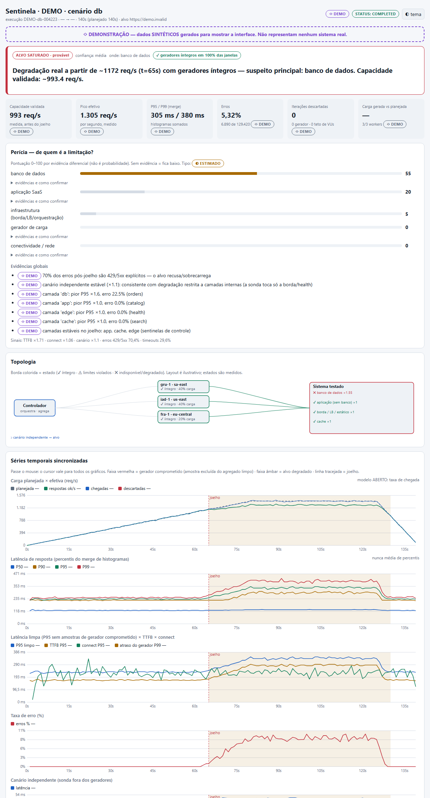
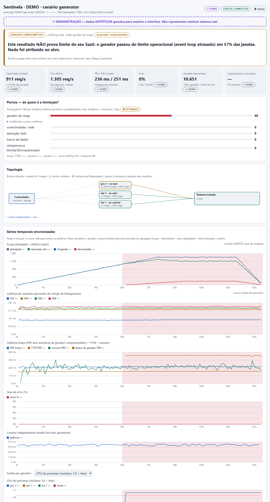
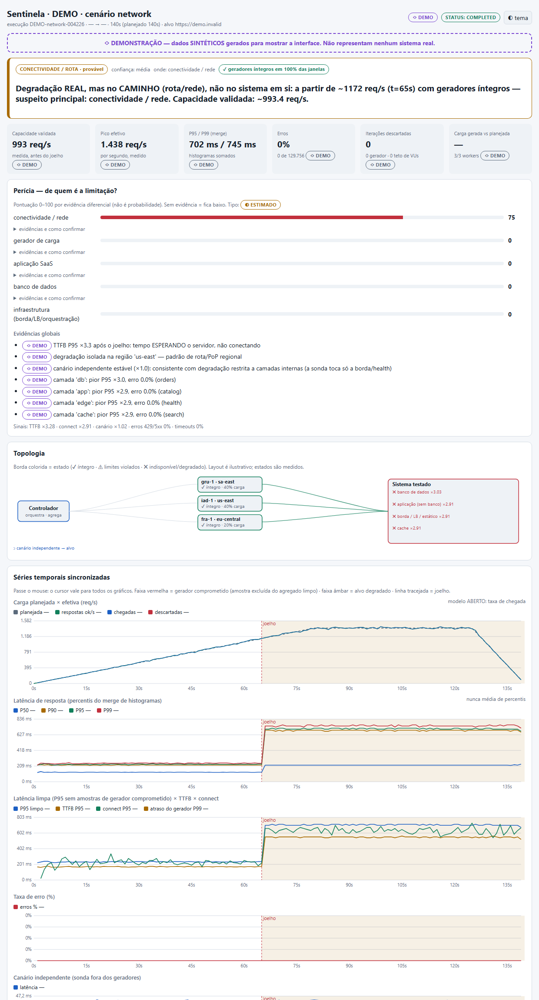

<div align="center">

#  SENTINELA

### Primeiro prove o gerador. Depois acuse o alvo.
### *Prove the load generator first. Then blame the target.*

**Teste de carga distribuído com perícia de gargalo · Distributed load testing with bottleneck forensics**

     

[🇧🇷 Português](#-português) · [🇺🇸 English](#-english)



<sub>Dashboard gerado automaticamente — dados SINTÉTICOS de demonstração / auto-generated dashboard — SYNTHETIC demo data</sub>

</div>

---

# 🇧🇷 Português

## O problema

> *"Não adianta fazer teste de carga saindo de uma máquina só, a rede limita sempre."*

Meio certo. Uma máquina **pode** gerar carga de sobra para muitos SaaS — mas **também pode** saturar CPU, event loop, portas efêmeras, descritores de arquivo ou banda e **mentir** no resultado. O pior: você sai do teste acusando a aplicação por uma lentidão que era do gerador.

A Sentinela não discute opinião. **Ela mede.**

## O que a torna diferente

| | |
|---|---|
| 📏 **Régua** | `calibrate` descobre o teto honesto de cada gerador contra um alvo nulo. Carga acima de 70% do teto = o gerador vai mentir. |
| 🩺 **Selo de integridade por segundo** | Cada worker se vigia: atraso do event loop, envio atrasado vs. planejado, CPU, RAM, portas efêmeras, FDs, descartes. Segundo violado é **excluído do agregado limpo**. |
| 🔬 **Sentinelas por camada** | Cada endpoint recebe uma `layer` (`edge`/`app`/`db`/`cache`/…). `/health` e `/app` planos + `/db` degradando = **banco**. Tudo junto = app/infra. Só uma região, com acréscimo em ms diferente das outras = **rota**. Diagnóstico diferencial, não palpite. |
| 🐦 **Canário independente** | Uma sonda **fora dos geradores** confirma se a degradação é real. |
| ⛓️ **Causa vs. consequência** | Gerador que piora *depois* do alvo, por excesso de conexões, é consequência — não invalida o resultado. |
| 🏷️ **Procedência em todo número** | `MEDIDO` · `ESTIMADO` · `DEMO` · `IMPORTADO`. Nada de número órfão. |
| 🧾 **Sempre entrega uma página** | Falhou? Abortou? Worker caiu? Você recebe um dashboard dizendo **o que aconteceu e o que ainda é confiável**. |
| 🙅 **Honestidade por contrato** | Sem evidência, o veredito é `INCONCLUSIVO` — e diz o que falta medir. |

## Instalação (30 segundos)

Zero dependências além do Python 3.9+.

```bash
git clone https://github.com/Djuniorss/sentinela ~/.claude/skills/sentinela
```

Depois, no seu assistente de código compatível com skills, basta digitar:

```
/sentinela
```

e descrever o que quer testar. A Sentinela conduz: monta o config, mostra o plano, pede autorização, calibra, executa e abre a perícia.

Prefere terminal puro? Funciona como CLI independente:

```bash
python scripts/loadlab.py demo --scenario db        # dashboard sintético (rotulado DEMO)
python scripts/loadlab.py sandbox --port 18080      # SaaS de brinquedo: o banco é o gargalo
python scripts/loadlab.py run assets/examples/sandbox.json --out results
```

## Veredito: de quem é a limitação?

| Estado | Significa |
|---|---|
| `GERADOR_COMPROMETIDO` | O gerador estourou antes. **Nada** é atribuído ao alvo. Refaça com mais workers. |
| `ALVO_SATURADO_CONFIRMADO` | Degradação real, geradores íntegros, **canário independente** confirmou. |
| `ALVO_SATURADO_PROVAVEL` | Degradação real com geradores íntegros; corroboração parcial. Aponta camada suspeita. |
| `CONECTIVIDADE_PROVAVEL` | Degradação real, mas **no caminho** (rota/região), não no sistema. |
| `SEM_SATURACAO` | Não achou o limite. Capacidade real **≥** pico testado. |
| `INCONCLUSIVO` | Dados insuficientes ou gerador não medido (ex.: import de JMeter). |
| `ABORTADO` | Critério de interrupção disparou; relatório parcial gerado. |

<p align="center"></p>
<p align="center"><sub>Cenário "gerador": o gerador saturou, então a Sentinela <b>se recusa a acusar o SaaS</b>.</sub></p>

## Funcionalidades

**Execução distribuída** — controlador central + workers independentes (processos locais, VMs remotas, regiões diferentes); divisão configurável por worker **sem duplicação** (taxas fracionadas somam 1; VUs por maior-resto; IDs intercalados); início sincronizado por offset de relógio; worker indisponível identificado e resultado parcial tratado; compatível com **k6**, **k6 Operator** e **Apache JMeter**.

**Carga** — `open` (taxa de chegada) e `closed` (VUs) **separados**: VUs ≠ RPS. Estágios, ramp-up/steady/ramp-down, think time, fluxos, pesos por endpoint, **multi-tenant** (uniforme/zipf/tenant quente) e detecção de vizinho barulhento.

**Saúde do gerador** — CPU, RAM, rede, conexões TCP, portas efêmeras, FDs, loop lag, atraso de envio, descartes, taxa de chegada real vs. planejada, erros por tipo.

**Dashboard (HTML único, offline, sem CDN)** — topologia, estado por worker, RPS efetivo, P50/P90/P95/P99 **por merge de histogramas** (nunca média de percentis), gráficos sincronizados com cursor compartilhado, comparação entre regiões, erros por endpoint, capacidade máxima **validada**, motivos técnicos, recomendações priorizadas por impacto, tema claro/escuro.

**Confiabilidade** — versões (app/scripts), config reproduzível, nº real de geradores, planejado vs. gerado, % de amostras perdidas, relógios, RTT de base, limitações e interferências. Critérios de aprovação e interrupção configuráveis.

**Segurança** — alvo fora do loopback exige bloco `authorization` (host, responsável, ambiente, validade, teto). Alta intensidade exige `--confirm "I-AUTHORIZE <host>"`; produção exige ainda `allow_production` e `PRODUCTION`. Sem isso, **nada** é enviado.

## Arquitetura

```
        ┌──────────────────── SENTINELA (controlador) ────────────────────┐
        │ plano · autorização · sync de relógio · agregação · abort ·     │
        │ perícia                                                         │
        └──────┬──────────────────┬──────────────────┬──────────┬─────────┘
               │ JSON/HTTP        │                  │          │ canário
        ┌──────▼───────┐   ┌──────▼───────┐   ┌──────▼───────┐  │ (fora dos
        │ worker gru-1 │   │ worker iad-1 │   │ worker fra-1 │  │ geradores)
        │ saúde/seg    │   │ saúde/seg    │   │ saúde/seg    │  │
        └──────┬───────┘   └──────┬───────┘   └──────┬───────┘  │
               └──────────────────┼──────────────────┘          │
                         ┌────────▼────────┐◄───────────────────┘
                         │   SaaS testado  │  edge · app · cache · db
                         └────────┬────────┘
                                  ▼
        dashboard.html · metrics.json · CSVs · config reproduzível · report.md
```

## Configuração mínima

```json
{
  "name": "meu-saas",
  "model": "open",
  "target": { "base_url": "https://staging.exemplo.com", "app_version": "1.42.0" },
  "canary_url": "https://staging.exemplo.com/health",
  "endpoints": [
    { "name": "health", "path": "/health",     "layer": "edge", "weight": 20 },
    { "name": "app",    "path": "/api/me",     "layer": "app",  "weight": 30 },
    { "name": "db",     "path": "/api/orders", "layer": "db",   "weight": 50 }
  ],
  "tenants": { "count": 50, "distribution": "zipf" },
  "stages": [
    { "duration": 60, "target": 800 },
    { "duration": 30, "target": 800 },
    { "duration": 10, "target": 0 }
  ],
  "workers": [
    { "id": "gru-1", "region": "sa-east", "url": "http://10.0.0.5:9101", "token_env": "TOKEN_GRU", "share": 0.5 },
    { "id": "iad-1", "region": "us-east", "url": "http://10.1.0.5:9101", "token_env": "TOKEN_IAD", "share": 0.5 }
  ],
  "criteria": {
    "pass":  { "p95_ms": 400, "error_rate": 0.01 },
    "abort": { "error_rate": 0.5, "window_s": 10, "canary_failures": 3 }
  },
  "authorization": {
    "target_host": "staging.exemplo.com", "authorized_by": "fulano@empresa",
    "environment": "staging", "expires": "2026-12-31", "max_rps": 1000
  }
}
```

> 💡 **Dica de ouro:** inclua sempre ao menos **um endpoint sem banco** (`layer: "app"` ou `"edge"`). É ele que permite à Sentinela separar app de banco.

## Comandos

| Comando | O que faz |
|---|---|
| `calibrate` | **Régua** — teto honesto deste gerador |
| `plan cfg.json` | mostra divisão de carga + portão de autorização (não envia nada) |
| `run cfg.json [--calibrate] [--confirm …]` | executa e **sempre** gera o relatório |
| `worker --host 0.0.0.0 --port 9101 --token T --region gru` | sobe um worker remoto |
| `demo --scenario db\|generator\|network\|healthy` | dashboard sintético para conhecer a interface |
| `sandbox` | SaaS de brinquedo local (banco = gargalo) para treinar a perícia |
| `ingest jtl\|k6 arquivo` | importa JMeter/k6 (veredito rebaixado: sem saúde do gerador) |
| `export cfg.json` | gera k6, segmentos k6, `TestRun` do k6 Operator e JMeter `-R` |

## k6, k6 Operator, JMeter e Kubernetes

- **k6 Operator**: o script leva a carga **total**; o operador fatia por *execution segment* (`parallelism`). Não divida à mão.
- **k6 multi-máquina**: `--execution-segment` com frações que somam 1.
- **JMeter `-R`**: *cada worker roda o plano inteiro* → threads são **por worker**. JMeter é modelo fechado; o Constant Throughput Timer só **aproxima** taxa de chegada.
- Detalhes em [`references/plataformas.md`](references/plataformas.md). Metodologia e limiares em [`references/metodologia.md`](references/metodologia.md).

## Limites (sim, nós dizemos)

- A Régua roda em **loopback**: mede CPU/event loop, não NIC nem rota até o alvo.
- Windows/macOS: parte das métricas do SO fica `n/a` (nunca inventada); portas efêmeras viram estimativa.
- "Banco culpado" é **inferência diferencial** (estimada). Para confirmar, olhe a telemetria do banco.
- O canal controlador↔worker não usa TLS: use rede privada/VPN/túnel.
- O `.jmx` gerado é template e não foi validado contra um JMeter real.
- Um worker nativo ≈ 1 núcleo. Para uma máquina inteira, suba N workers.

## Contribuindo

PRs são bem-vindos: novos sinais de perícia, métricas de SO, importadores (Gatling, Locust, Artillery), TLS no canal de controle, mais cenários no `demo`. Rode `demo` nos 4 cenários e o `sandbox` antes de abrir PR.

---

# 🇺🇸 English

## The problem

> *"Load testing from a single machine is pointless — the network always limits you."*

Half right. One machine **can** generate plenty of load for many SaaS apps — but it **can also** saturate CPU, its event loop, ephemeral ports, file descriptors or bandwidth, and **lie** in the results. Worst case: you walk away blaming the application for slowness that came from the generator.

Sentinela doesn't argue opinions. **It measures.**

## What makes it different

| | |
|---|---|
| 📏 **Ruler** | `calibrate` finds each generator's honest ceiling against a null target. Load above 70% of it = the generator will lie. |
| 🩺 **Per-second integrity seal** | Every worker watches itself: event-loop lag, send lateness vs. plan, CPU, RAM, ephemeral ports, FDs, dropped iterations. A violated second is **excluded from the clean aggregate**. |
| 🔬 **Layer sentinels** | Tag each endpoint with a `layer` (`edge`/`app`/`db`/`cache`/…). Flat `/health` + flat `/app` + degrading `/db` = **database**. Everything together = app/infra. One region only, with a different added-ms = **network path**. Differential diagnosis, not guesswork. |
| 🐦 **Independent canary** | A probe **outside the generators** confirms whether the degradation is real. |
| ⛓️ **Cause vs. consequence** | A generator that degrades *after* the target, because of connection pile-up, is a consequence — not a reason to discard the result. |
| 🏷️ **Provenance on every number** | `MEASURED` · `ESTIMATED` · `DEMO` · `IMPORTED`. No orphan numbers. |
| 🧾 **Always delivers a page** | Failed? Aborted? Worker died? You still get a dashboard stating **what happened and what's still trustworthy**. |
| 🙅 **Honesty by contract** | Without evidence the verdict is `INCONCLUSIVO` (inconclusive) — and it tells you what's missing. |

## Install (30 seconds)

Zero dependencies beyond Python 3.9+.

```bash
git clone https://github.com/Djuniorss/sentinela ~/.claude/skills/sentinela
```

Then, in your skills-compatible coding assistant, just type:

```
/sentinela
```

and describe what you want to test. Sentinela drives the flow: builds the config, shows the plan, asks for authorization, calibrates, runs, and opens the forensics.

Prefer plain terminal? It's a standalone CLI too:

```bash
python scripts/loadlab.py demo --scenario db        # synthetic dashboard (labeled DEMO)
python scripts/loadlab.py sandbox --port 18080      # toy SaaS: the DB is the bottleneck
python scripts/loadlab.py run assets/examples/sandbox.json --out results
```

## Verdict: whose limit is it?

| State | Meaning |
|---|---|
| `GERADOR_COMPROMETIDO` (generator compromised) | The generator broke first. **Nothing** is attributed to the target. Re-run with more workers. |
| `ALVO_SATURADO_CONFIRMADO` (target saturated, confirmed) | Real degradation, healthy generators, **independent canary** agrees. |
| `ALVO_SATURADO_PROVAVEL` (probable) | Real degradation with healthy generators; partial corroboration. Names the suspect layer. |
| `CONECTIVIDADE_PROVAVEL` (connectivity) | Real degradation, but **on the path** (route/region), not the system. |
| `SEM_SATURACAO` (no saturation) | Limit not found. Real capacity is **≥** tested peak. |
| `INCONCLUSIVO` (inconclusive) | Not enough data, or generator not measured (e.g. imported JMeter results). |
| `ABORTADO` (aborted) | A stop criterion fired; partial report generated. |

<p align="center"></p>
<p align="center"><sub>"Network" scenario: only one region degrades, with a different added latency — the verdict points at the <b>path</b>, not the app.</sub></p>

## Features

**Distributed execution** — central controller + independent workers (local processes, remote VMs, multiple regions); configurable per-worker split **with no accidental duplication** (fractional rates sum to 1; VUs by largest remainder; interleaved IDs); synchronized start via clock-offset handshake; unavailable workers detected and partial results handled; compatible with **k6**, **k6 Operator** and **Apache JMeter**.

**Workload** — `open` (arrival rate) and `closed` (VUs) are **kept separate**: VUs ≠ RPS. Stages, ramp-up/steady/ramp-down, think time, flows, per-endpoint weights, **multi-tenant** (uniform/zipf/hot tenant) and noisy-neighbor detection.

**Generator health** — CPU, RAM, network, TCP connections, ephemeral ports, FDs, loop lag, send lateness, drops, achieved vs. planned arrival rate, errors by type.

**Dashboard (single HTML, offline, no CDN)** — topology, per-worker status, effective RPS, P50/P90/P95/P99 **via merged histograms** (never averaged percentiles), synchronized charts with a shared cursor, region comparison, per-endpoint errors, **validated** max capacity, technical reasons, impact-ranked recommendations, light/dark theme.

**Reliability** — app/script versions, reproducible config, real generator count, planned vs. generated load, % lost samples, clocks, baseline RTT, limitations and interference. Configurable pass and abort criteria.

**Safety** — non-loopback targets require an `authorization` block (host, owner, environment, expiry, cap). High intensity requires `--confirm "I-AUTHORIZE <host>"`; production additionally needs `allow_production` and `PRODUCTION`. Without them, **nothing** is sent.

## Commands

| Command | What it does |
|---|---|
| `calibrate` | **Ruler** — this generator's honest ceiling |
| `plan cfg.json` | shows load split + authorization gate (sends nothing) |
| `run cfg.json [--calibrate] [--confirm …]` | runs and **always** produces the report |
| `worker --host 0.0.0.0 --port 9101 --token T --region gru` | starts a remote worker |
| `demo --scenario db\|generator\|network\|healthy` | synthetic dashboard to explore the UI |
| `sandbox` | local toy SaaS (DB = bottleneck) to train the forensics |
| `ingest jtl\|k6 file` | imports JMeter/k6 (verdict downgraded: no generator health) |
| `export cfg.json` | emits k6, k6 segments, k6 Operator `TestRun` and JMeter `-R` |

## k6, k6 Operator, JMeter and Kubernetes

- **k6 Operator**: the script carries the **total** load; the operator slices it by execution segment (`parallelism`). Don't divide by hand.
- **Multi-machine k6**: `--execution-segment` with fractions summing to 1.
- **JMeter `-R`**: *every worker runs the whole plan* → threads are **per worker**. JMeter is a closed model; Constant Throughput Timer only **approximates** arrival rate.
- Details in [`references/plataformas.md`](references/plataformas.md); methodology and thresholds in [`references/metodologia.md`](references/metodologia.md) (Portuguese).

## Limits (yes, we say them out loud)

- The Ruler runs over **loopback**: it measures CPU/event loop, not the NIC or the route to the target.
- Windows/macOS: some OS metrics are `n/a` (never invented); ephemeral ports become estimates.
- "Database is guilty" is **differential inference** (estimated). Confirm with the database's own telemetry.
- The controller↔worker channel is not TLS: use a private network/VPN/tunnel.
- The generated `.jmx` is a template, not validated against a real JMeter.
- One native worker ≈ 1 CPU core. To use a whole machine, run N workers.

## Contributing

PRs welcome: new forensic signals, OS metrics, importers (Gatling, Locust, Artillery), TLS on the control channel, more `demo` scenarios. Please run the 4 `demo` scenarios and the `sandbox` before opening a PR.

---

<div align="center">

**MIT License** · Feito com 🛰️ para quem cansou de culpar a aplicação errada · Made for everyone tired of blaming the wrong thing

</div>
